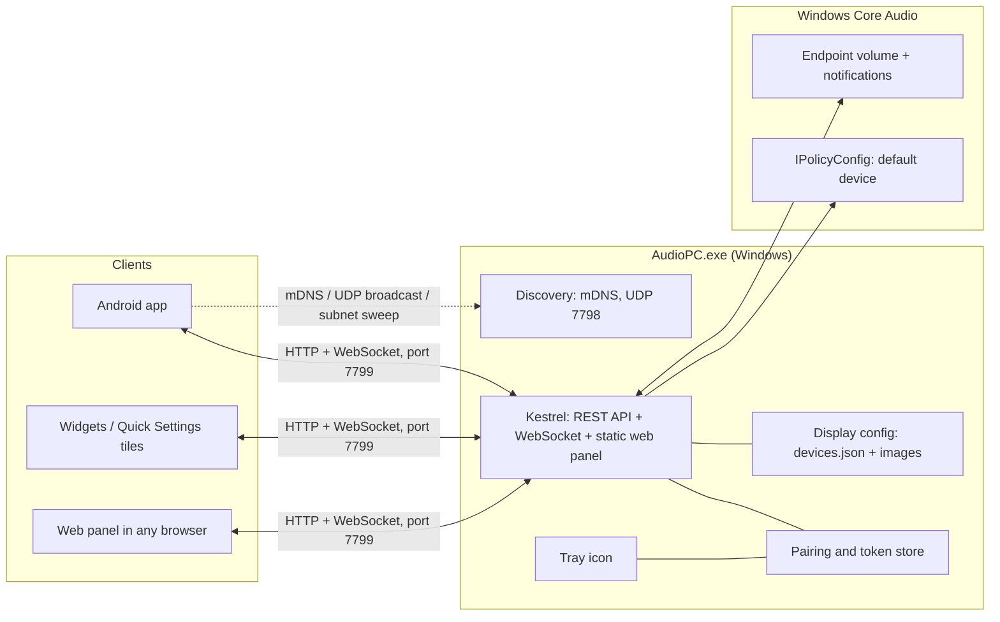

# Architecture

Audio PC has two halves: a single Windows executable (`AudioPC.exe`) that owns the audio
devices, and clients (Android app, widgets, tiles, web panel) that talk to it over the LAN.
The wire contract is in [API.md](API.md).

## Components

- **Kestrel host** — serves the JSON API under `/api/`, the live-event WebSocket
  (`/api/events`), the legacy Home Assistant endpoints (`/audio/*`) and the web panel
  (embedded static files at `/`).
- **Pairing and auth** — a 6-digit code is shown on the PC; confirming it yields a per-device
  token. Only the SHA-256 hash of each token is stored (`paired.json`). Devices can be revoked
  from the tray menu.
- **Discovery** — the server announces `_audiopc._tcp` over mDNS and answers
  `AUDIOPC_DISCOVER 1` UDP datagrams on port 7798. Clients identify a PC by its `serverId`,
  so IP changes are transparent.
- **Tray icon** — WinForms `NotifyIcon`: start with Windows, paired devices / revoke, open data folder.
- **Display config** — `devices.json` and `images/` in `%APPDATA%\AudioPC` give outputs their
  friendly name, kind and photo; a file watcher applies edits live.
- **Core Audio layer** — enumerates active playback endpoints, switches the default device
  for all roles through the undocumented `IPolicyConfig` COM interface, and reads/writes
  volume and mute through the endpoint volume interface. Change notifications (default
  device, device added/removed, volume/mute) are pushed to WebSocket clients, including
  changes made from Windows itself.

## Request flow (switching the output)

1. The client sends `POST /api/output` with its bearer token.
2. The server validates the token hash, resolves the device and calls `IPolicyConfig`.
3. Windows raises a default-device-changed notification.
4. The server broadcasts a `state` message on `/api/events`; every connected client updates.
